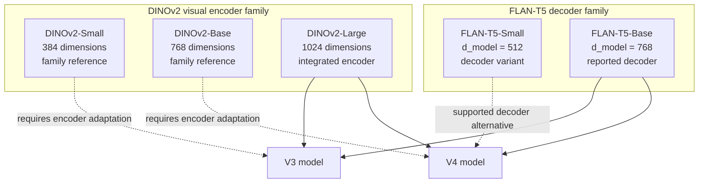
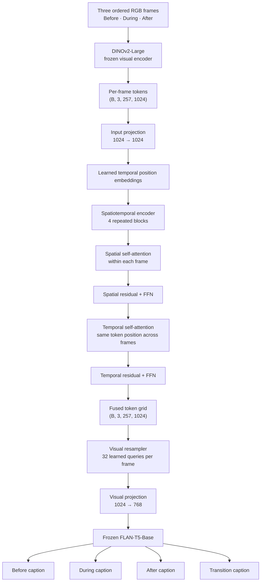
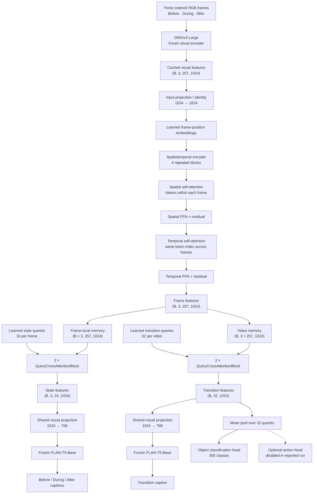

# Semantic Object State Transition Detection

**OSCaR-Lite: Structured State Captioning and Semantic Transition Generation from Video**

[](https://www.python.org/) [](https://pytorch.org/) [](https://huggingface.co/datasets/ali-vosoughi/oscar-dataset)

A research implementation for understanding what an object looks like, how its state evolves, and what semantic transition occurs across a short video sequence. Given three temporally ordered frames, the system generates descriptions for the before, during, and after stages, together with a video-level transition caption.

The repository currently contains implemented **V3 and V4** models. V1 and V2 are intentionally left as placeholders until their source code is added.

## Table of contents

- [Motivation and task](#motivation-and-task)
- [Dataset](#dataset)
- [Backbone families](#backbone-families)
- [Implemented models](#implemented-models)
- [Mathematical formulation](#mathematical-formulation)
- [Training setup](#training-setup)
- [Evaluation protocol](#evaluation-protocol)
- [Quantitative results](#quantitative-results)
- [Qualitative transition examples](#qualitative-transition-examples)
- [Comparison with original OSCaR](#comparison-with-original-oscar)
- [Limitations](#limitations)
- [Repository structure](#repository-structure)
- [Setup and usage](#setup-and-usage)
- [References](#references)

## Motivation and task

Image captioning describes a visual observation. Video understanding must additionally account for temporal relationships: what was true before an action, what is observed while it unfolds, and what is different afterward.

Given three ordered frames:

```python
F = [F_before, F_during, F_after]
```

the model generates four outputs:

| Output | Meaning |
|---|---|
| `C_before` | State/scene description associated with the first frame |
| `C_during` | State/scene description associated with the second frame |
| `C_after` | State/scene description associated with the third frame |
| `C_transition` | Video-level description of the evolution across the sequence |

Frame captions describe observations; the transition caption should connect those observations into a coherent temporal account. This system is not a physical simulator and does not directly estimate forces or hidden object properties that are not visually supported.

## Dataset

### OSCaR

Experiments use the [OSCaR dataset](https://huggingface.co/datasets/ali-vosoughi/oscar-dataset), introduced by Nguyen et al. (2024), *OSCaR: Object State Captioning and State Change Representation*, Findings of NAACL 2024.

OSCaR was curated from egocentric video collections, notably EPIC-KITCHENS and Ego4D. The paper introduces object-state captioning and object-state-change captioning as natural-language tasks and describes a benchmark with human-verified captions.

The repository's dataset exploration identified the following metadata characteristics for the dataset version used in this project:

| Property | Observed value |
|---|---:|
| Metadata records | 30,308 |
| Unique training clips | 7,077 |
| Training object classes | 305 |
| Frames per temporal sample | 3 |
| Temporal ordering | Before → During → After |

These counts describe the project's inspected metadata/split, not the full counts of every subset described in the OSCaR paper. The paper separately reports a curated collection of 14,084 annotated video segments and its own 500-video benchmark. Those totals should not be conflated.

### Visual preprocessing and cached features

The feature extraction pipeline uses DINOv2 at 224 × 224 resolution. With a patch size of 14, the patch grid is 16 × 16:

```python
patch_tokens = (224 // 14) * (224 // 14)  # 256
cls_tokens = 1
total_tokens = patch_tokens + cls_tokens  # 257
feature_dim = 1024  # DINOv2-Large
frames = 3

cached_sample_shape = (B, frames, total_tokens, feature_dim)
# (B, 3, 257, 1024)
```

Precomputing visual features avoids repeatedly running the frozen visual encoder during caption-model training. The final V3 and V4 experiments use `data/OSCaR/cached_features_v3_large`.

## Backbone families

The model family is described using multiple DINOv2 and FLAN-T5 sizes. The current V3/V4 visual-encoder wrappers are **hard-coded to DINOv2-Large**; DINOv2-Small and DINOv2-Base are included below as family/reference configurations, not as selectable options in the current encoder implementation. The FLAN-T5 decoder supports Small and Base variants. All reported experiments use **DINOv2-Large + FLAN-T5-Base**.

### DINOv2 visual encoders

DINOv2 is a self-supervised vision Transformer family. The encoder's final hidden-state tokens are used as visual representations. With 224 × 224 inputs and 14 × 14 patches, the output contains one CLS token and 256 patch tokens.

| Variant | Hugging Face model ID | Hidden dimension | Transformer blocks | Patch size | Tokens at 224² |
|---|---|---:|---:|---:|---:|
| DINOv2-Small | `facebook/dinov2-small` | 384 | 12 | 14 | 257 |
| DINOv2-Base | `facebook/dinov2-base` | 768 | 12 | 14 | 257 |
| DINOv2-Large | `facebook/dinov2-large` | 1024 | 24 | 14 | 257 |

```python
small_features = (B, 257, 384)
base_features  = (B, 257, 768)
large_features = (B, 257, 1024)
```

The temporal fusion input dimension must match the selected encoder output dimension. In the checked-in V3/V4 encoder wrappers, `MODEL_NAME`, `HIDDEN_SIZE`, and the expected layer count are fixed to DINOv2-Large; using Small or Base requires adapting the encoder wrapper and downstream temporal dimensions.

### FLAN-T5 language decoders

Visual embeddings are projected into the language model's `d_model` dimension and passed through the `inputs_embeds` interface.

| Variant | Hugging Face model ID | `d_model` |
|---|---|---:|
| FLAN-T5-Small | `google/flan-t5-small` | 512 |
| FLAN-T5-Base | `google/flan-t5-base` | 768 |

The decoder implementation supports `google/flan-t5-small` and `google/flan-t5-base`, as well as frozen or selective fine-tuning configurations. The reported V3/V4 experiments use frozen FLAN-T5-Base.

### Backbone choices represented in the model family



DINOv2-Small/Base and FLAN-T5-Small are documented as supported family variants, not as evaluated experiments here. The performance tables below are for DINOv2-Large and FLAN-T5-Base only.

## Implemented models

### V1

### V2

### V3 — factorized spatiotemporal fusion

V3 is the first model version reported here. It uses a frozen DINOv2-Large encoder, factorized spatial/temporal Transformer fusion, a learned visual resampler, a visual projection, and a frozen FLAN-T5-Base language model.

#### V3 architecture



#### V3 processing details

1. **Visual encoding:** DINOv2-Large extracts one CLS token and 256 patch tokens for each frame.
2. **Spatial attention:** visual tokens within a frame attend to other tokens in that frame.
3. **Temporal attention:** at each token position, representations attend across the ordered frames.
4. **Visual resampling:** 32 learned queries independently retrieve information from each temporally fused frame representation.
5. **Projection:** the 1024-dimensional visual representation is mapped to FLAN-T5-Base's 768-dimensional embedding space.
6. **Language generation:** frame-specific visual tokens supervise the three state captions; the temporally fused visual representation also conditions transition-caption generation.

#### V3 configuration

| Parameter | Value |
|---|---:|
| Visual backbone | DINOv2-Large (frozen) |
| Input frames | 3 |
| Visual tokens per frame | 257 |
| Feature dimension | 1024 |
| Temporal hidden dimension | 1024 |
| Attention heads | 16 |
| Factorized blocks | 4 |
| Resampler queries | 32 per frame |
| Visual projection | 1024 → 768 |
| Language decoder | FLAN-T5-Base (frozen) |
| State target length | 128 tokens |
| Transition target length | 128 tokens |
| Dropout | 0.1 |

### V4 — hierarchical spatiotemporal captioner

V4 uses the same factorized spatiotemporal token encoder but replaces V3's single shared visual resampling path with **separate learned-query paths for state and transition captioning**:

- Frame-local state queries attend to tokens from each individual frame. Those frame tokens already contain temporal context from the shared encoder.
- Video-level transition queries attend to the concatenated visual-token memory from all frames.

This separates the representation used for a frame-level state description from the representation used for the sequence-level transition description.

#### V4 architecture



#### V4 feature paths

**Shared spatiotemporal encoder.** Input features have shape `(B, 3, 257, 1024)`. Each of four blocks performs spatial multi-head self-attention independently within each frame, followed by temporal multi-head self-attention across frames for each token slot. Residual connections, layer normalization, and feed-forward networks are included. The result is `(B, 3, 257, 1024)`.

**Frame-level state path.** Frame features are reshaped to `(B × 3, 257, 1024)`. Each frame receives 16 learned state queries. Two query cross-attention blocks allow each frame's queries to retrieve information from its corresponding frame memory. The state representation is `(B, 3, 16, 1024)`, projected to 768 dimensions, and passed to FLAN-T5-Base for the three state captions.

Although the query memory is frame-local at this stage, its tokens already contain temporal context from the shared encoder.

**Video-level transition path.** Frame tokens are concatenated into a video memory of shape `(B, 3 × 257, 1024)`. Thirty-two learned transition queries retrieve information from this joint memory through two query cross-attention blocks. The resulting representation `(B, 32, 1024)` is projected to 768 dimensions and passed to FLAN-T5-Base to generate the transition caption.

**Auxiliary object classification.** The transition query representation is mean-pooled across 32 queries and passed to an object classification head. The reported training configuration uses 305 classes and an object loss weight of 0.05. The code also exposes an optional action head, but the reported configuration does not enable action classification; its presence in the API is not an action-recognition result.

#### V4 configuration

| Parameter | Value |
|---|---:|
| Visual backbone | DINOv2-Large (frozen) |
| Input frames | 3 |
| Visual tokens per frame | 257 |
| Feature dimension | 1024 |
| Spatiotemporal hidden dimension | 1024 |
| Attention heads | 16 |
| Spatiotemporal blocks | 4 |
| State queries | 16 per frame |
| Transition queries | 32 per video |
| Query cross-attention blocks | 2 per path |
| Visual projection | 1024 → 768 |
| Language decoder | FLAN-T5-Base (frozen) |
| Object classes | 305 |
| Object loss weight | 0.05 |
| State target length | 128 tokens |
| Transition target length | 128 tokens |
| Dropout | 0.1 |

## Mathematical formulation

The expressions below use code-style notation for convenient copying into implementation notes.

### Input and feature extraction

```python
F = [F_before, F_during, F_after]
X = DINOv2(F)
# X: (B, T=3, N=257, D=1024) for DINOv2-Large
```

### Factorized spatial and temporal attention

```python
X_spatial = X + MultiHeadAttention(
    query=LayerNorm(X),
    key=LayerNorm(X),
    value=LayerNorm(X),
    attention_axis='spatial_tokens_within_each_frame',
)

X_temporal = X_spatial + MultiHeadAttention(
    query=LayerNorm(X_spatial),
    key=LayerNorm(X_spatial),
    value=LayerNorm(X_spatial),
    attention_axis='same_token_slot_across_frames',
)
```

Each block also contains residual feed-forward transformations and normalization. Four blocks are stacked in V3 and V4.

### V3 visual resampling

```python
Q = LearnedQueries(shape=(32, 1024))

for t in range(3):
    Z_state[t] = CrossAttention(
        query=Q,
        key=X_temporal[t],
        value=X_temporal[t],
    )
# Z_state: (B, 3, 32, 1024)
```

### V4 hierarchical query decoding

```python
Q_state = LearnedStateQueries(shape=(16, 1024))
Z_state = QueryDecoder(
    queries=Q_state,
    memory=X_temporal,
    memory_scope='separate_memory_per_frame',
    layers=2,
)
# Z_state: (B, 3, 16, 1024)

M_video = reshape(X_temporal, (B, 3 * 257, 1024))
Q_transition = LearnedTransitionQueries(shape=(32, 1024))
Z_transition = QueryDecoder(
    queries=Q_transition,
    memory=M_video,
    memory_scope='all_frames_jointly',
    layers=2,
)
# Z_transition: (B, 32, 1024)
```

### Visual-to-language projection and multi-task objective

```python
E_state = Linear(1024, 768)(Z_state)
E_transition = Linear(1024, 768)(Z_transition)

L_total = (
    1.00 * L_state
    + 1.00 * L_transition
    + 0.05 * L_object
)
```

`L_state` and `L_transition` are language-model caption generation losses. `L_object` is the auxiliary object-classification cross-entropy loss. V3 uses the two caption objectives without the V4 auxiliary object-classification term.

## Training setup

The reported V3 and V4 experiments use the following main optimization settings:

| Setting | Value |
|---|---:|
| Epochs | 50 |
| Random seed | 42 |
| Batch size | 8 |
| Optimizer | AdamW |
| Learning rate | 1e-4 |
| Weight decay | 1e-4 |
| Scheduler | ReduceLROnPlateau |
| Scheduler factor | 0.5 |
| Scheduler patience | 3 |
| Minimum learning rate | 1e-6 |
| Early-stopping patience | 8 |
| Gradient clipping | 1.0 |
| Mixed precision | Enabled |
| State loss weight | 1.0 |
| Transition loss weight | 1.0 |
| V4 object loss weight | 0.05 |

The visual encoder and FLAN-T5-Base decoder are frozen in the reported experiments. The trainable temporal and projection modules learn to map DINOv2 representations into the frozen language model's embedding space.

## Evaluation protocol

V3 and V4 were evaluated on 500 validation samples. Each sample produces four captions, resulting in 2,000 caption-level comparisons per model.

| Metric | Interpretation |
|---|---|
| BLEU-1 | Unigram overlap |
| BLEU-2 | Bigram overlap |
| BLEU-3 | Trigram overlap |
| BLEU-4 | Four-gram overlap |
| ROUGE-L | Longest-common-subsequence based overlap |
| Semantic similarity | Embedding-based semantic correspondence between generated and reference descriptions |

A caption is counted as low-similarity when its semantic similarity score is below `0.5`. Automatic metrics are useful for comparison but do not directly guarantee correct object identity, physical validity, or causal correctness.

## Quantitative results

### Overall comparison: V3 vs V4.1

| Metric | V3 | V4.1 | Change |
|---|---:|---:|---:|
| Overall temporal score | 0.5660 | **0.6257** | +0.0597 |
| Low-similarity captions | 715 / 2000 | **462 / 2000** | -253 |
| Low-similarity rate | 35.75% | **23.10%** | -12.65 percentage points |

The overall temporal score is the arithmetic mean of the four stage-level semantic-alignment scores (`before`, `during`, `after`, and `transition`) computed on samples with all four valid references. It increased by approximately **10.55% relative** to V3:

```python
absolute_gain = 0.6257 - 0.5660  # 0.0597
relative_gain_percent = (0.0597 / 0.5660) * 100  # ≈ 10.55%
```

The number of low-similarity captions decreased by approximately **35.4%**:

```python
reduction_percent = ((715 - 462) / 715) * 100  # ≈ 35.4%
```

### Stage-wise caption metrics

#### V3

| Stage | BLEU-1 | BLEU-2 | BLEU-3 | BLEU-4 | ROUGE-L | Semantic similarity |
|---|---:|---:|---:|---:|---:|---:|
| Before | 0.3377 | 0.1659 | 0.0835 | 0.0435 | 0.2247 | 0.5528 |
| During | 0.3149 | 0.1624 | 0.0815 | 0.0416 | 0.2332 | 0.5553 |
| After | 0.3127 | 0.1609 | 0.0812 | 0.0423 | 0.2262 | 0.5548 |
| Transition | 0.3261 | 0.1788 | 0.0986 | 0.0589 | 0.2525 | 0.6012 |

#### V4.1

| Stage | BLEU-1 | BLEU-2 | BLEU-3 | BLEU-4 | ROUGE-L | Semantic similarity |
|---|---:|---:|---:|---:|---:|---:|
| Before | 0.3430 | 0.1743 | 0.0908 | 0.0484 | 0.2252 | 0.6167 |
| During | 0.3217 | 0.1738 | 0.0912 | 0.0496 | 0.2340 | 0.6185 |
| After | 0.3170 | 0.1715 | 0.0922 | 0.0502 | 0.2322 | 0.6092 |
| Transition | 0.3857 | 0.2104 | 0.1164 | 0.0705 | 0.2593 | 0.6583 |

### Semantic similarity by stage

| Stage | V3 | V4.1 | Absolute improvement |
|---|---:|---:|---:|
| Before | 0.5528 | **0.6167** | +0.0639 |
| During | 0.5553 | **0.6185** | +0.0632 |
| After | 0.5548 | **0.6092** | +0.0544 |
| Transition | 0.6012 | **0.6583** | +0.0571 |

All four stages improved in V4.1. Transition captions had the highest semantic similarity for both models.

### Low-similarity cases by stage

| Stage | V3 count | V3 rate | V4.1 count | V4.1 rate |
|---|---:|---:|---:|---:|
| Before | 205 | 41.0% | 133 | 26.6% |
| During | 183 | 36.6% | 114 | 22.8% |
| After | 191 | 38.2% | 122 | 24.4% |
| Transition | 136 | 27.2% | 93 | 18.6% |
| **Total** | **715** | **35.75%** | **462** | **23.10%** |

### Evaluation plots and reports

Generated evaluation artifacts are stored alongside the reports:

| Artifact | V3 | V4.1 |
|---|---|---|
| Stage metrics | [V3 plot](outputs/evaluations/v3_frozen/stage_metrics.png) | [V4 plot](outputs/evaluations/v4/stage_metrics.png) |
| Temporal alignment | [V3 plot](outputs/evaluations/v3_frozen/temporal_alignment.png) | [V4 plot](outputs/evaluations/v4/temporal_alignment.png) |
| Prediction/reference browser | [V3 browser](outputs/evaluations/v3_frozen/visual_comparison.html) | [V4 browser](outputs/evaluations/v4/visual_comparison.html) |
| Full report | [V3 report](outputs/evaluations/v3_frozen/report.md) | [V4 report](outputs/evaluations/v4/report.md) |

The HTML visual comparison pages show the three input frames alongside generated and reference captions for the four output categories.

## Qualitative transition examples

The following examples are copied from the V4 evaluation's prediction/reference browser. They are representative model outputs, not manually corrected captions.

### Input frame triplets

| Event | Before | During | After |
|---|---|---|---|
| Drawer opening |  |  |  |
| Gas control knob |  |  |  |
| Bottle closing |  |  |  |

### Example 1 — Opening a drawer

**Object/action metadata:** drawer · open drawer

**V4 transition prediction**

> Over the sequence of frames, the kitchen drawer undergoes a transition from being partially open to being fully open. Initially, the drawer is partially open, revealing a kitchen drawer with its contents in view. As the drawer's contents move through the frame, the person's hand interacts with it, indicating a deliberate action. By the final frame, there is a clearer understanding of the individual's interaction with the drawer, suggesting that the drawer may be open for a specific purpose.

**Reference transition**

> As the drawer opens progressively from the first to the third frame, there's a clear transition from partial visibility to full exposure of its contents. Initially, only a fraction of the drawer's items is visible, mainly knives and some cutlery. As the drawer opens further, more items are revealed, expanding the view to include a variety of kitchen tools. The final frame shows the drawer in its fully extended state, displaying an orderly arrangement of utensils, which reflects a well-stocked and systematically organized kitchen drawer. Throughout these transitions, the orderliness of the drawer's contents remains intact, suggesting a functional and well-maintained storage system.

**Observation:** The prediction identifies the main change—progressive drawer opening—but provides less detail about how the visible contents expand and introduces a speculative purpose.

### Example 2 — Turning a gas-stove control knob

**Object/action metadata:** gas · open gas

**V4 transition prediction**

> Over the course of these three frames, there's a clear progression from an inert state to a gas-free state. Initially, the gas burner is in a state of disintegration, indicating that the gas has been removed from the burner. As a result, the flame is reduced to its original state, suggesting that the burner has been turned off. As the sequence progresses, the hand's motion reveals a gradual reduction in the gas's output, implying that there is no longer enough gas in the burner for the desired effect. By the final frame, ...

**Reference transition**

> Throughout the sequence, there is a progressive motion of the gas knob from the off position towards what is assumed to be the ignition point. The individual's fingers adjust their grip and rotate the knob with increasing intent, but despite these actions, there is no visible sign of a flame, which indicates that the gas may be on but not lit, or the ignition is so subtle that it escapes notice from this perspective. The constant in the scene is the presence of kitchen items that remain static, emphasizing the focused action on the gas stove's control knob.

**Observation:** The prediction fails to preserve the reference's central temporal evidence: the control knob rotates while no flame is visible. It invents a gas-removal/turn-off interpretation.

### Example 3 — Closing a bottle

**Object/action metadata:** bottle · close bottle

**V4 transition prediction**

> Over the course of these three frames, there is a clear progression in the state of the water. Initially, the water is in a state of rest, with the glass still in place. As the frame progresses, it becomes more apparent that the water has been drained, indicating a deliberate action. By the final frame, the glass is still in its original state, and the water's surface is clearly visible. This sequence captures a moment when a person engages in something important, such as a drink, or a conversation. The transition from a static state to ...

**Reference transition**

> The sequence of these frames captures the progression of closing a bottle. Initially, the bottle stands open with the cap beside it, then transitions to the cap being guided towards the bottle's mouth, and finally, the cap makes contact with the bottle's neck as the hand prepares to twist it closed. Throughout the sequence, the hand's movements are deliberate and controlled, indicating a careful attempt to reseal the bottle without spillage. The subtle shift in the hand's position and the changing angle of the cap provide a clear visual narrative of the cap being secured back onto the bottle.

**Observation:** This prediction confuses the bottle/cap interaction with a water/glass event. Object identity and action-object grounding remain important failure modes.

More frame-level examples are available in the [V4 visual comparison browser](outputs/evaluations/v4/visual_comparison.html).

## Comparison with original OSCaR

This project is grounded in the problem formulation and dataset introduced by Nguyen et al. (2024). The original paper is the foundational reference, not an unrelated baseline.

### Original OSCaR method

The paper's reported OSCaR model fine-tunes LLaVA with OSCaR instruction data. Its experiments use CLIP ViT-Large-Patch14-336 as the visual encoder and Vicuna 7B/13B as the language model, with LoRA fine-tuning (rank 128, alpha 256). The paper studies a broader instruction-following setting that includes state captioning, state-change captioning, visual question answering, and visual dialogue.

### Architectural comparison

| Dimension | Original OSCaR paper | This project: V3 / V4 |
|---|---|---|
| Research task | Object-state captioning and state-change representation | Structured before/during/after and transition captioning |
| Visual backbone | CLIP ViT-Large-Patch14-336 | DINOv2-Large |
| Language model | Vicuna 7B / 13B | FLAN-T5-Base |
| Language model adaptation | LoRA fine-tuning | Frozen decoder in reported experiments |
| Temporal mechanism | LLaVA-style visual instruction conditioning over selected frames | Explicit factorized spatial/temporal attention |
| Learned query resampling | Not described as the same separate state/transition query design | V3 shared per-frame resampler; V4 separate state and transition query paths |
| Auxiliary object classification | Not reported as the same auxiliary training loss | V4 305-class auxiliary object head |
| Output interface | Broader visual instruction/QA/dialogue tasks | Four structured captions per temporal sample |
| Evaluation | Text metrics, GPT-4V judging, human preference and open-world evaluation | BLEU-1..4, ROUGE-L, semantic similarity and qualitative inspection |

### Original OSCaR reported text metrics

The paper's Table 2 reports these results on its benchmark:

| Model | BLEU | ROUGE-1 | ROUGE-2 | ROUGE-L |
|---|---:|---:|---:|---:|
| OSCaR 13B (OSCaR data only) | 5.28 | 27.93 | 7.67 | 24.45 |
| OSCaR 7B (OSCaR data only) | 5.10 | 28.27 | 7.42 | 24.77 |
| OSCaR 13B (mixed data) | 5.76 | 29.26 | 8.24 | 25.78 |
| OSCaR 7B (mixed data) | 5.79 | 29.94 | 8.34 | 26.24 |

The paper's table uses its own reported BLEU/ROUGE scale and metric setup. These values must **not** be directly ranked against this repository's stage-specific BLEU-1 through BLEU-4 and ROUGE-L values. A defensible numerical comparison requires identical samples, references, tokenization, metric implementations, and aggregation.

The paper also reports human preference results: OSCaR received 73.93% favorable selections and GPT-4V received 82.5% in the study described in the paper. This repository has not conducted an equivalent human study. The original paper's reported text metrics and human-study percentages are contextual results, not directly comparable to the V3/V4 scores reported above.

### Positioning

The project does not claim to introduce object-state-change understanding or to outperform the original OSCaR system. Its investigation is architectural: it compares factorized temporal fusion (V3) with a hierarchical representation that separates frame-level state-query decoding from video-level transition-query decoding (V4). The V3-to-V4 improvement is internal to this project and uses its own evaluation pipeline.

## Limitations

1. **Three-frame temporal sampling.** Events with important intermediate steps, long duration, or delayed effects may be missed.
2. **Object identity errors.** Qualitative examples show confusion between objects, such as a bottle/cap event being described as a water/glass event.
3. **Action and transition hallucination.** The model may infer a cause, intention, or physical state that is not supported by the frames. The gas-knob example illustrates this.
4. **Generic descriptions.** Some predictions identify a broad scene change but omit the specific visual evidence that distinguishes the event.
5. **Auxiliary object-classification generalization.** V4 validation object accuracy was approximately 49.4% and macro-F1 approximately 0.465, despite much lower training loss. This indicates a generalization gap in the auxiliary classification branch.
6. **No equivalent human evaluation.** The original OSCaR paper includes human assessment; the reported V3/V4 comparison relies on automatic metrics and qualitative inspection.
7. **No project open-world evaluation.** Equivalent unseen-object and out-of-domain experiments have not been performed here.
8. **Metric limitations.** BLEU/ROUGE are wording-sensitive; embedding similarity can reward semantically related but visually incorrect descriptions. Neither directly measures physical validity or causal correctness.
9. **No controlled V4 component ablation.** V4 changes multiple connected elements relative to V3. Current results do not isolate each component's contribution.
10. **Single reported validation run.** The documented comparison uses 500 validation samples. Results across multiple random seeds and larger evaluation subsets are not reported.

### Research directions

- Object-centric region features or explicit tracking to improve identity consistency.
- Longer temporal windows or adaptive frame sampling.
- Temporal consistency constraints across before/during/after captions.
- Better grounding of action verbs and manipulated objects.
- Controlled ablations of query count, temporal depth, and auxiliary object supervision.
- Multi-seed evaluation and confidence intervals.
- Human evaluation and open-world testing using protocols comparable to the original OSCaR paper.

## Repository structure

```text
semantic-state-transition-detection/
├── configs/
│   ├── oscar_lite_v3_captioning.json
│   ├── oscar_lite_v3_evaluation.json
│   ├── oscar_lite_v4_captioning.json
│   └── oscar_lite_v4_evaluation.json
├── outputs/
│   └── evaluations/
│       ├── v3_frozen/
│       │   ├── report.md
│       │   ├── stage_metrics.png
│       │   ├── temporal_alignment.png
│       │   └── visual_comparison.html
│       └── v4/
│           ├── report.md
│           ├── stage_metrics.png
│           ├── temporal_alignment.png
│           └── visual_comparison.html
├── scripts/
│   ├── dataset_download.py
│   ├── precompute_dinov2_features.py
│   ├── evaluate.py
│   ├── evaluate_v3.py
│   └── inspect_oscar_temporal_samples.py
├── src/sostd/
│   ├── data/
│   ├── evaluation/
│   ├── models/
│   │   ├── v3/
│   │   └── v4/
│   └── training/
├── tests/
├── main.py
├── pyproject.toml
└── uv.lock
```

Large local datasets, cached features, and checkpoints may not be tracked in Git. Their paths are configurable.

## Setup and usage

### Requirements

- Python 3.11 or newer
- PyTorch/torchvision compatible with the target CUDA environment (the lockfile specifies the CUDA 12.8 PyTorch index)
- Sufficient GPU memory for the selected model and batch size
- Hugging Face access for model and dataset downloads

### Install

```bash
git clone https://github.com/prasangeet/semantic-state-transition-detection.git
cd semantic-state-transition-detection
uv sync
```

### Dataset and feature preparation

The dataset downloader retrieves OSCaR into `data/OSCaR/`. You must first accept the dataset's Hugging Face access conditions. The script optionally reads `HF_TOKEN` from a project-root `.env` file:

```bash
uv run python scripts/dataset_download.py
```

The DINOv2-Large feature-precomputation script uses CUDA device `cuda:0` and writes to `data/OSCaR/cached_features_v3_large`:

```bash
uv run python scripts/precompute_dinov2_features.py
```

The expected cached feature shape per sample is `(3, 257, 1024)`. The script skips cache files that pass its shape/content validation.

### Training

The V3/V4 captioning trainer is exposed by `src/sostd/training/captioning_main.py`. Select the corresponding JSON configuration explicitly:

```bash
# Train V3
uv run python -m src.sostd.training.captioning_main --config configs/oscar_lite_v3_captioning.json

# Train V4
uv run python -m src.sostd.training.captioning_main --config configs/oscar_lite_v4_captioning.json
```

Add `--resume` to resume from the latest checkpoint, or `--no-resume` to force a fresh run. The V4 trainer builds its object vocabulary from the training split and saves it in the checkpoint directory.

> **V3 config compatibility:** the checked-in `configs/oscar_lite_v3_captioning.json` currently declares top-level `version: "v3-frozen"`, but the trainer accepts only `"v3"` and `"v4"`. Before running the V3 command, change that field to `"v3"` (or make the same change in a copy of the config). The V4 config already declares `"v4"`.

> **Entrypoint note:** `uv run python main.py --train` currently routes to `src/sostd/training/main.py`, which is a dataset-inspection/annotation-statistics routine and explicitly notes that temporal training data construction is not implemented there. Use `src.sostd.training.captioning_main` for V3/V4 captioning training.

### Evaluation

Run the version-specific evaluation scripts with their explicit configurations:

```bash
# Evaluate V3
uv run python scripts/evaluate_v3.py --config configs/oscar_lite_v3_evaluation.json

# Evaluate V4
uv run python scripts/evaluate.py --config configs/oscar_lite_v4_evaluation.json
```

Both scripts write reports and visual-comparison artifacts under `outputs/evaluations/` as configured in the JSON files.

### Tests

```bash
uv run pytest
```

## Reproducibility notes

- V3 and V4 evaluations each use 500 validation samples.
- Each sample yields four captions, giving 2,000 caption-level comparisons per model.
- Both reported models use DINOv2-Large cached features with 257 tokens and 1024 dimensions per frame.
- V4 introduces dedicated state and transition query paths and an auxiliary object classification head.
- The overall temporal score is an aggregate defined by this project's evaluation implementation. It is not a standard metric reported by the original OSCaR paper.
- Stored evaluation reports and visual comparison files are the primary experiment artifacts.
- No V1/V2 architecture or performance claims are made.

## References

1. Nguyen, N., Bi, J., Vosoughi, A., Tian, Y., Fazli, P., & Xu, C. (2024). **OSCaR: Object State Captioning and State Change Representation.** Findings of the Association for Computational Linguistics: NAACL 2024, pp. 3565–3576. [ACL Anthology](https://aclanthology.org/2024.findings-naacl.226/) · [PDF](https://aclanthology.org/2024.findings-naacl.226.pdf) · [Project repository](https://github.com/nguyennm1024/OSCaR).
2. Oquab, M. et al. (2023). **DINOv2: Learning Robust Visual Features without Supervision.** [arXiv:2304.07193](https://arxiv.org/abs/2304.07193) · [Official implementation](https://github.com/facebookresearch/dinov2).
3. Chung, H. W. et al. (2022). **Scaling Instruction-Finetuned Language Models.** [arXiv:2210.11416](https://arxiv.org/abs/2210.11416).
4. Raffel, C. et al. (2020). **Exploring the Limits of Transfer Learning with a Unified Text-to-Text Transformer.** JMLR, 21(140), 1–67. [JMLR](https://jmlr.org/papers/v21/20-074.html).
5. Damen, D. et al. (2018). **Scaling Egocentric Vision: The EPIC-KITCHENS Dataset.** [arXiv:1804.02748](https://arxiv.org/abs/1804.02748).
6. Grauman, K. et al. (2022). **Ego4D: Around the World in 3,000 Hours of Egocentric Video.** CVPR 2022. [Project website](https://ego4d-data.org/) · [CVF paper](https://openaccess.thecvf.com/content/CVPR2022/html/Grauman_Ego4D_Around_the_World_in_3000_Hours_of_Egocentric_Video_CVPR_2022_paper.html).
7. Papineni, K., Roukos, S., Ward, T., & Zhu, W.-J. (2002). **BLEU: a Method for Automatic Evaluation of Machine Translation.** ACL 2002. [ACL Anthology](https://aclanthology.org/P02-1040/).
8. Lin, C.-Y. (2004). **ROUGE: A Package for Automatic Evaluation of Summaries.** ACL 2004. [ACL Anthology](https://aclanthology.org/W04-1013/).

## Acknowledgements

This project builds on the OSCaR dataset and research direction introduced by Nguyen et al. and uses publicly available DINOv2 and FLAN-T5 model families. Please cite the original dataset and relevant model papers when using this work.

## Citation

If you use this implementation, cite the original OSCaR work:

```bibtex
@inproceedings{nguyen2024oscar,
  title     = {OSCaR: Object State Captioning and State Change Representation},
  author    = {Nguyen, Nguyen and Bi, Jing and Vosoughi, Ali and Tian, Yapeng and Fazli, Pooyan and Xu, Chenliang},
  booktitle = {Findings of the Association for Computational Linguistics: NAACL 2024},
  pages     = {3565--3576},
  year      = {2024}
}
```

**Project repository:** https://github.com/prasangeet/semantic-state-transition-detection